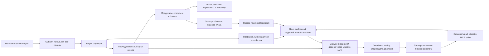

# День 35 — локальный Android AI QA-ассистент

Python-приложение исследует Android-приложение со списком задач по цели, написанной обычным языком. DeepSeek выбирает следующий шаг по текущему экрану и истории действий, официальный Maestro MCP выполняет ограниченное действие на явно выбранном видимом эмуляторе, а ассистент проверяет результат по UI-дереву и доступным assertions. Скриншоты, проверки и отчёт остаются локально; подтверждённые сценарии можно сохранить как обычные Maestro YAML flows и повторять без LLM.

Целевое приложение этого репозитория — «На сегодня» (`ru.natoday.app`). Если передать другое приложение, встроенные сценарные требования нужно сверить с его документацией: неизвестные правила помечаются `unspecified`, а не считаются ожидаемым поведением.

## Что проверяется

Четыре независимых сценария создают собственные задачи с уникальным именем `AIQA-<run-id>-<scenario>`:

| Сценарий | Основные проверки |
|---|---|
| `create-task` | создание на выбранный день, видимые поля и значения, отсутствие дубля при доступном покрытии, сохранение после перезапуска |
| `move-task` | исходная дата, перенос на следующий календарный день, отсутствие в исходном дне, наличие в новом, сохранение названия и статуса |
| `change-status` | исходное и изменённое семантическое состояние, доступный фильтр, сохранение после перезапуска, обратное переключение, если оно поддерживается |
| `delete-task` | отмена подтверждения, если предусмотрена, затем удаление только тестовой задачи и отсутствие после перезапуска |

`lifecycle` — дополнительный общий сценарий «создание → перенос → статус → удаление». Его результат не заменяет результаты независимых сценариев. Очистка тестовых данных ограничена задачей текущего запуска и режимом, указанным в конфигурации; глобальная очистка приложения по умолчанию не выполняется.

У каждой проверки один из статусов: `passed`, `failed`, `blocked`, `not_checked`. Статус `passed` требует ожидаемого результата, наблюдения после действия, конкретного предиката и ссылки на доказательство. Ошибка приложения отделена от сбоя модели, MCP или устройства. Визуальная гипотеза AI остаётся предварительной, пока её нельзя подтвердить наблюдением.

## Схема работы



Цикл выполняет на одном устройстве только одно действие за раз: получить свежее наблюдение → запросить решение модели → проверить вызов → вызвать Maestro MCP → снова получить наблюдение → оценить проверку. Координаты не переносятся между изменениями экрана. При timeout ассистент сначала проверяет состояние и не повторяет потенциально уже выполненное создание задачи автоматически.

```text
CLI / Web → Run manager → ADB preflight → Agent
                                      ├─ DeepSeek API (планирование)
                                      ├─ Tool registry (allowlist и валидация)
                                      └─ Maestro MCP (управление UI)
Agent → observations → checks → reports / screenshots / generated flows
```

Веб-панель работает только на loopback (`127.0.0.1`): показывает доступные сценарии, ход и статус выполнения, проверки и связанные с проблемами скриншоты. Она не открывает произвольные инструменты модели или универсальное выполнение shell-команд.

## Устройство и Android-приложение

В этом репозитории есть исходники приложения, поэтому используется режим анализа кода; black-box режим нужен только для внешнего APK без исходников. Android-модуль — `app`, Compose UI, Room и DataStore; application ID — `ru.natoday.app`; доступны варианты debug/release. Версии Android-зависимостей находятся в `gradle/libs.versions.toml`. Debug APK собирается командой `:app:assembleDebug`.

Эмулятор остаётся видимым. Перед сценарием веб-клиент проверяет выбранный ADB serial и готовность Android. Если указанное устройство — выключенный `emulator-<port>`, клиент может запустить **явно заданный** AVD и дождаться `sys.boot_completed=1`. При нескольких AVD укажите `--avd`; случайный AVD или физический телефон не выбирается. Для обычного сценария APK не переустанавливается. Существующие Android instrumentation tests очищают данные приложения — не запускайте их на AVD с нужными пользовательскими данными.

## Требования

- Windows 10/11, PowerShell, Python 3.11 или новее.
- Java и Android SDK с `adb`; для локальной сборки — Android SDK-компоненты проекта.
- Установленный Android Emulator с AVD или подключённое физическое тестовое устройство.
- Maestro для Windows той версии, которую поддерживает проект; bootstrap проверяет закреплённый архив.
- DeepSeek API key для агентных запусков. Replay уже созданного flow ключа не требует.

На проверенной машине использовались Python 3.12, Java 21 и Android SDK `D:\AndroidSDK`. Поддержка Windows относится к этой конфигурации Maestro; WSL и самописная Node.js-прослойка здесь не используются. Установка ПО с повышением прав автоматически не выполняется.

## Установка в Windows PowerShell

Откройте PowerShell в корне репозитория. Скрипт создаёт виртуальное окружение, устанавливает зависимости из lock-файла и при флаге скачивает проверенную Windows-сборку Maestro.

```powershell
cd D:\AIAdvent\advent-day-35-android-ai-qa
Set-ExecutionPolicy -Scope Process -ExecutionPolicy Bypass
.\setup.ps1 -DownloadMaestro
```

Изменение Execution Policy действует только в текущем окне PowerShell. Можно вовсе не активировать окружение и вызывать его Python напрямую — это также работает при запрещённом запуске `Activate.ps1`:

```powershell
$py = ".\tools\android-ai-qa\.venv\Scripts\python.exe"
```

Создайте локальный файл настроек и добавьте ключ самостоятельно:

```powershell
Copy-Item .env.example .env
notepad .env
```

`DEEPSEEK_API_KEY` указывается только в локальном `.env` или окружении. Файл `.env` игнорируется Git. Не вставляйте ключ в команду, issue, скриншот, отчёт или flow. `.env` читается только когда команда получила `--env-file .env`; иначе используются переменные текущего процесса. Пример настроек без секретов есть в `.env.example`, YAML-конфигурация — в `qa/config.example.yaml`.

Порядок приоритета: аргументы CLI → переменные окружения → YAML-конфигурация → безопасные значения по умолчанию. Помимо переменных DeepSeek, поля конфигурации доступны через `ANDROID_QA_<FIELD>`. Модель задаётся в `DEEPSEEK_MODEL`; отдельная `DEEPSEEK_VISION_MODEL` необязательна.

## Проверка окружения и сборка APK

Сначала запустите AVD через Android Studio Device Manager или Android CLI. Окно эмулятора оставьте открытым. Убедитесь, что serial взят из фактического вывода ADB:

```powershell
android emulator list
android emulator start NaTodayCalendarTest
D:\AndroidSDK\platform-tools\adb.exe devices -l
```

Если приложение ещё не установлено, соберите и установите debug APK отдельно:

```powershell
.\gradlew.bat :app:assembleDebug
& $py -m android_qa install-apk --device emulator-5554 --apk app/build/outputs/apk/debug/app-debug.apk
```

Замените `emulator-5554` на ваш serial. При нескольких подключённых устройствах `--device` обязателен. Встроенные сценарии работают с тестовыми данными приложения, не очищают его целиком и не требуют тестового аккаунта.

Обычная диагностика не обращается к платному API:

```powershell
& $py -m android_qa doctor --device emulator-5554 --app-id ru.natoday.app --env-file .env
```

Вызов с `--check-api` дополнительно отправляет текстовый запрос, проверяет tool calling и небольшое изображение, включая сочетание изображения с инструментами для заданной модели. Он расходует API-квоту:

```powershell
& $py -m android_qa doctor --check-api --device emulator-5554 --app-id ru.natoday.app --env-file .env
```

## Запуск сценариев

Сценарии и цель можно задавать через CLI:

```powershell
& $py -m android_qa run --device emulator-5554 --app-id ru.natoday.app --repo . --env-file .env --goal "Создай задачу на сегодня и проверь сохранение"
& $py -m android_qa suite --device emulator-5554 --app-id ru.natoday.app --env-file .env
& $py -m android_qa suite --device emulator-5554 --app-id ru.natoday.app --env-file .env --scenario lifecycle
```

Локальная веб-панель:

```powershell
& $py -m android_qa web --device emulator-5554 --avd NaTodayCalendarTest --app-id ru.natoday.app --env-file .env --port 8765
```

Откройте `http://127.0.0.1:8765`, выберите сценарий, наблюдайте за прогрессом и откройте итог конкретной проверки для просмотра evidence. Во время запуска на экране Android Emulator видны реальные нажатия и переходы. На одном устройстве разрешён только один активный сценарий. Остановить сервер можно `Ctrl+C` в его терминале.

Повтор экспортированного flow запускается без DeepSeek:

```powershell
& $py -m android_qa replay --device emulator-5554 --flow qa/flows/create-task.yaml
```

В начале команд доступна справка:

```powershell
& $py -m android_qa --help
& $py -m android_qa run --help
```

## Проверка поведения и экспорт

QA-спецификации сценариев находятся в `qa/specs/`; в них требования отделены от наблюдаемого поведения, неизвестные продуктовые правила имеют пометку `unspecified`. Отдельные сценарии изолированы; успешное автоматическое удаление относится только к тестовой задаче текущего запуска. По умолчанию агент не удаляет пользовательские задачи и не сбрасывает данные приложения.

После исследования исходников можно предложить новый flow. Для каждого сценария при доступных исходниках исследуются релевантные исходный код, документация и тесты; в отчёте фиксируются ссылки и хеши. Если исходников нет, используйте `--black-box`, и анализ кода будет отмечен как недоступный.

```powershell
& $py -m android_qa generate --repo . --env-file .env --goal "Создай Maestro flow для проверки создания задачи"
```

После запуска можно посмотреть diff предложения к QA-документации. Применение — отдельная команда, выполняемая пользователем после просмотра patch; автоматического изменения Android production-кода нет:

```powershell
& $py -m android_qa docs-diff --repo . --report artifacts/android-qa/<run-id>
& $py -m android_qa docs-apply --repo . --report artifacts/android-qa/<run-id>
```

Экспортёр создаёт обычный Maestro YAML с selectors и assertions, где они доступны. Новый flow должен быть воспроизведён прежде, чем считаться проверенным; если replay не прошёл, он помечается `unverified` с причиной. Запускайте replay и сценарии только на тестовом устройстве и тестовом профиле приложения.

## Результаты и диагностика

Каждый запуск создаёт каталог `artifacts/android-qa/<run-id>/`:

```text
run.json             цель, пакет, устройство, версия Android, Git-состояние и capabilities
events.jsonl         последовательность инструментальных действий и краткие результаты
checks.json          проверяемые предикаты, статусы и ссылки на evidence
report.md            человекочитаемый итог и причина остановки
screenshots/         снимки экранов, привязанные к наблюдениям/проверкам
hierarchy/           сохранённые UI-деревья
logs/                ограниченные диагностические логи
generated-flows/     экспортированные Maestro flows и статус replay
proposals/           подготовленные diff QA-документации, если они есть
```

В терминале отображаются шаг, действие, краткий результат, статус проверки и путь к отчёту. При сбое устройства или MCP результат будет `blocked`, а не успешный прогон. Причина отказа модели, приложения и инструмента разделяется, насколько это подтверждено доступными данными.

## Данные, приватность и ограничения

- Python-агент не входит в APK. Работа агента и MCP выполняется локально, управление Android идёт через выбранный ADB device.
- Для планирования DeepSeek получает цель, нормализованное UI-дерево, нужные фрагменты истории/требований и выбранные изображения, если модель поддерживает image input. Секреты API и скрытые рассуждения в отчёты не записываются; полные запросы не логируются.
- Снимки и отчёты могут включать видимые на экране данные. Не используйте production-аккаунты и храните локальные артефакты соответственно чувствительности данных. `.env` и `artifacts/` исключены из Git.
- Если выбранная модель не принимает изображения, остаются функциональная работа по UI-дереву и сохранение скриншотов; визуальный статус будет `not_checked`. Провайдер автоматически не переключается.
- Maestro на зафиксированной версии ограничивает Unicode-ввод: ASCII-ввод не подтверждает проверку кириллицы. Лимит длины названия, поведение длинных строк и другие неподтверждённые правила не считаются требованиями.
- Bounds и screenshot сами по себе не доказывают контрастность, dp-размер touch target или доступность. Визуальные выводы модели — предварительные, пока их нельзя подтвердить.
- Тестовые данные могут отправляться внешнему API вместе с видимым UI-контекстом. Не помещайте в тестовые задачи персональные сведения, пароли и одноразовые коды.

## Разработка и проверки

Python-зависимости и транзитивные версии закреплены `uv.lock`:

```powershell
uv sync --project tools/android-ai-qa --frozen
& $py -m pytest tools/android-ai-qa/tests -q
.\gradlew.bat :app:testDebugUnitTest :app:lintDebug :app:assembleDebug :app:assembleDebugAndroidTest
```

Python unit-тесты используют явно обозначенные mock DeepSeek/MCP для логики, валидации, ошибок и экспорта. Они не доказывают реальное прохождение приложения. Статус реальных проверок, устройство, API и воспроизведённые flows перечисляются в [`docs/verification.md`](docs/verification.md). Источники переиспользованных компонентов описаны в [`docs/provenance.md`](docs/provenance.md).
